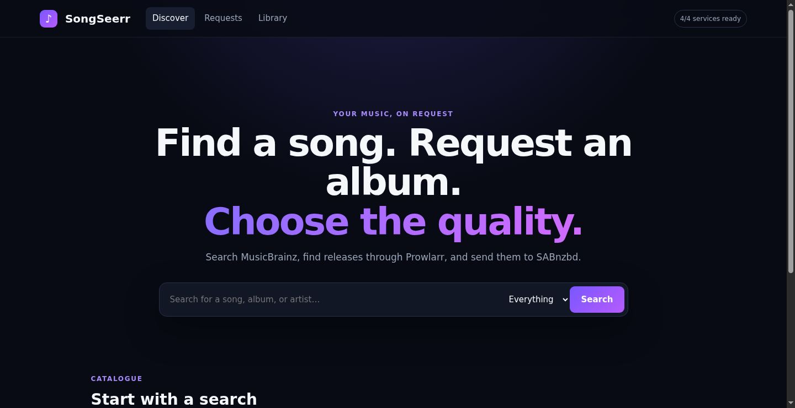
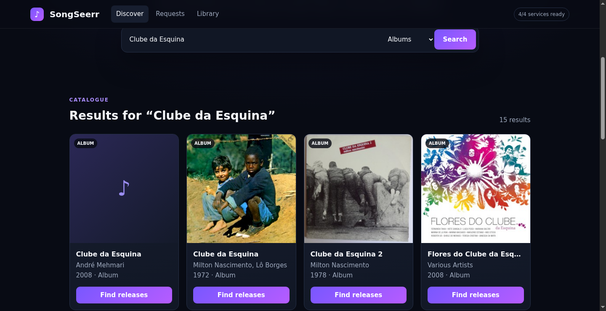
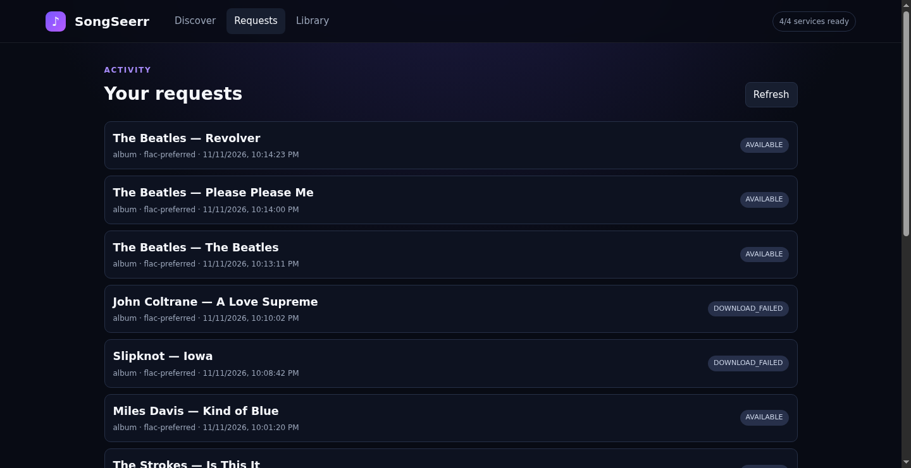
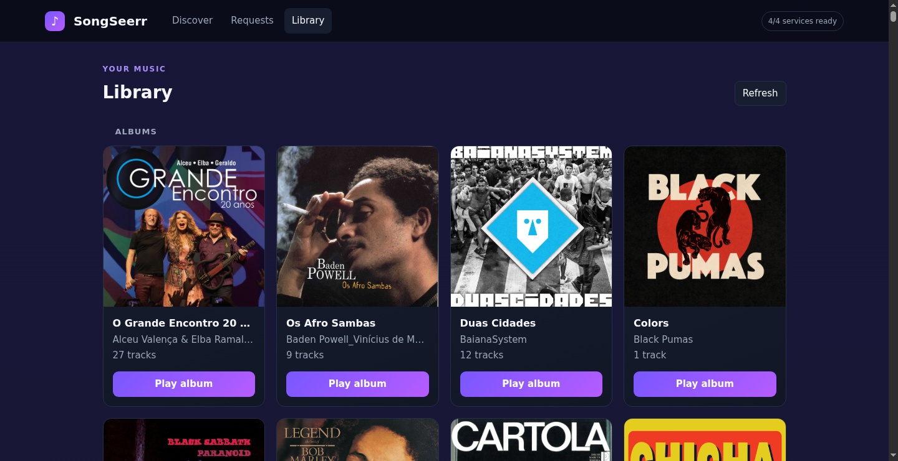
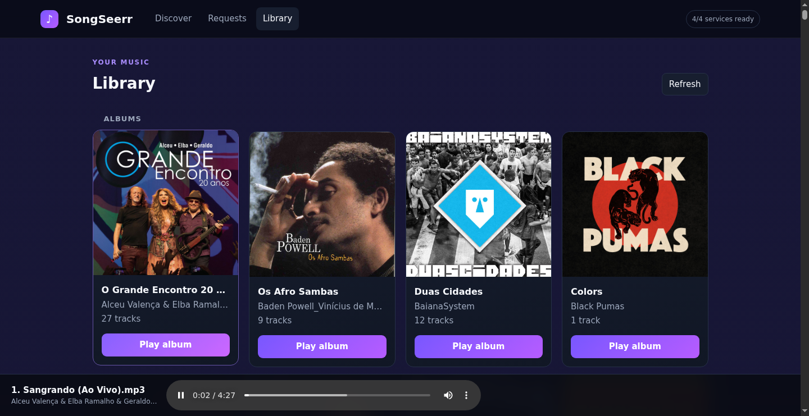

# 🐴 SongSeerr

**Find a song. Request an album. Choose the quality.**

SongSeerr is a self-hosted, Seerr-style request manager for *individual songs and albums* — the missing "arr" app for music. Search MusicBrainz for metadata, find releases through [Prowlarr](https://prowlarr.com), rank them by real audio quality (not just seeders), and send the winning release straight to [SABnzbd](https://sabnzbd.org). Once it's downloaded, SongSeerr verifies, tags, and imports the files into your library — and you can browse and play that library right from the same app.



## Why SongSeerr?

Sonarr/Radarr/Lidarr cover TV, movies, and whole artist discographies — but none of them are built around a simple "I want this one song / this one album" workflow with FLAC-vs-MP3 quality control. SongSeerr is a small, single-purpose app for exactly that, inspired by how Overseerr/Jellyseerr work for video.

## Features

- 🔍 **Search** songs, albums, and artists via MusicBrainz, with cover art.
- 🎚️ **Quality profiles**: `flac-only`, `flac-preferred`, `mp3-preferred`, `mp3-only` — FLAC always strictly outranks MP3 under a "preferred" profile, regardless of seeder/grab counts.
- 📡 **Prowlarr integration**: searches all your configured indexers through Prowlarr's unified API; indexer URLs and API keys never reach the browser.
- 📥 **SABnzbd integration**: submits the chosen NZB directly, polls the queue/history, and reacts to completion or failure.
- ✅ **Verified imports**: every downloaded file is probed with `ffprobe` and fully decode-checked with `ffmpeg` before it's published — no silently-corrupt files in your library.
- 🎯 **Precise song extraction**: for single-song requests where the indexer only has the full album, SongSeerr identifies and extracts exactly the right track (by MusicBrainz ID, or by title/artist/duration match) and leaves everything else untouched.
- 🛡️ **Path-traversal safe**: completed downloads are mapped into a read-only mount and validated against symlink/traversal attacks before anything is copied.
- 🎵 **Built-in library + player**: browse everything that's been imported (and anything already in your music folder) as albums or loose tracks, with a persistent in-app audio player that auto-advances the queue.
- 🐳 **Docker / Compose / Umbrel** packaging included.
- **Zero runtime npm dependencies** — just Node's built-ins.

## Screenshots

| Search & cover art | Your requests |
| --- | --- |
|  |  |

| Library | In-app player |
| --- | --- |
|  |  |

## How it works

1. Search MusicBrainz for a song or album.
2. Song requests are mapped to their containing album when indexers only publish full releases.
3. SongSeerr searches Prowlarr's music category and ranks results by your chosen quality profile.
4. The backend fetches the winning NZB from Prowlarr (server-side only) and uploads it to SABnzbd.
5. SongSeerr polls SABnzbd's queue/history until the job completes, fails, or needs attention.
6. The completed path is mapped into a read-only download mount; symlinks, traversal, and special files are rejected.
7. Every file is codec-probed and fully decode-verified.
8. The complete album — or the one unambiguous requested track — is imported into your library without touching anything else already there.
9. Browse and play everything from the **Library** tab.

## Quick start

### 1. A download pipeline

You need:
- A **Prowlarr** instance with at least one Usenet indexer (e.g. [NZBgeek](https://nzbgeek.info), DOGnzb, DrunkenSlug...). Prowlarr requires `redirect: true` for Usenet indexers — this is normal, SongSeerr follows it server-side only.
- A **Usenet provider** / news server for SABnzbd to actually download from — a paid block account (Newshosting, Eweka, Tweaknews...) or a service like [TorBox](https://torbox.app) Pro, which ships its own NNTP news server.
- A running **SABnzbd** instance connected to that provider.

### 2. Configure

```bash
cp .env.example .env
# Edit .env with your Prowlarr and SABnzbd URLs/API keys
```

### 3. Run

```bash
npm test
npm start
```

Open `http://localhost:8788`.

### Docker

```bash
cp .env.example .env
docker compose up --build -d
```

When Prowlarr/SABnzbd run as separate containers, use their container/service names in `.env` instead of `localhost`:

```dotenv
PROWLARR_URL=http://prowlarr:9696
SABNZBD_URL=http://sabnzbd:8080
```

## Configuration reference

| Variable | Purpose |
| --- | --- |
| `PORT`, `HOST` | HTTP listener |
| `DATA_DIR` | Persistent request database directory |
| `MUSICBRAINZ_USER_AGENT` | Identifies this installation to MusicBrainz; include a contact address |
| `PROWLARR_URL`, `PROWLARR_API_KEY` | Prowlarr API connection |
| `SABNZBD_URL`, `SABNZBD_API_KEY` | SABnzbd API connection |
| `SABNZBD_CATEGORY` | SABnzbd category to submit to (default `music`) |
| `SABNZBD_COMPLETE_DIR` | Completed path as reported by SABnzbd |
| `DOWNLOAD_DIR` | The same completed files, mounted **read-only** inside SongSeerr |
| `MUSIC_LIBRARY_DIR` | Writable destination for verified imports; also the root the Library tab scans |
| `MONITOR_INTERVAL_MS` | Queue polling period; minimum 5 seconds |
| `FFPROBE_PATH`, `FFMPEG_PATH` | Media-tool executables |
| `DEFAULT_QUALITY` | `flac-only`, `flac-preferred`, `mp3-preferred`, or `mp3-only` |

Never commit `.env` — it's already in `.gitignore`.

## Library tab

The Library tab scans `MUSIC_LIBRARY_DIR` for:
- **Albums**: any nested folder containing audio files, grouped as `artist/album`, with a `cover.jpg`/`cover.png` picked up automatically if present.
- **Loose tracks**: files directly at the library root, parsed using the common `Artist - Album - Track.ext` naming convention when present.

Everything streams with HTTP Range support, so seeking works, and the player auto-advances through the current album or track list.

## Troubleshooting

- **Downloads fail immediately with a redirect-related error**: make sure you're on a version that follows Usenet indexer redirects server-side (fixed in `v0.2.1`+). Prowlarr forces `redirect: true` for all Usenet indexer definitions by design.
- **SABnzbd returns `403 hostname-check`**: add the hostname SongSeerr uses to reach SABnzbd (e.g. `host.docker.internal`) to SABnzbd's *Settings → Special → host_whitelist*.
- **Import fails right after a successful download**: double-check that `SABNZBD_COMPLETE_DIR` / `DOWNLOAD_DIR` actually match the *root* SABnzbd reports in its history (`storage` field) — a category `dir` starting with `/` in SABnzbd is treated as an absolute override and can silently point outside that root.
- **Cover art is blank**: coverartarchive.org redirects to `archive.org`, which redirects again to a per-request CDN subdomain. If you're running behind a custom reverse proxy with its own CSP, allow `https://archive.org` and `https://*.archive.org` in `img-src` in addition to `https://coverartarchive.org`.

## Umbrel package

A community-store package lives under `umbrel/`. It mounts the shared Umbrel downloads directory read-only and lets the user pick a writable music-library folder. Before public store submission, the container image reference must be published and pinned to a multi-architecture digest (`image@sha256:...`), and the official Umbrel app linter must pass.

## Development

```bash
npm run dev    # restart on file changes
npm test       # Node's built-in test runner
```

The backend uses Node's built-in HTTP server and test runner, and the frontend is static HTML/CSS/JS with no build step — this keeps the project small and easy to audit, self-host, and package.

## Security notes

- Indexer download URLs, API keys, and NZB GUIDs are never sent to the browser — only opaque, server-cached candidate IDs are.
- NZB download redirects are only ever followed server-side; the bytes returned to SABnzbd never pass back through the client.
- All library/import file paths are resolved with `realpath` and checked against their configured root before any read, write, or stream — rejecting symlinks, `..` traversal, and special files.

## Contributing

Issues and pull requests are welcome. Please run `npm test` and keep commits scoped and described in [Conventional Commits](https://www.conventionalcommits.org/) style.

## License

GPL-3.0-only. No Lidarr source has been copied into this project. Any future reuse of Lidarr code will retain required notices and GPLv3 obligations.
